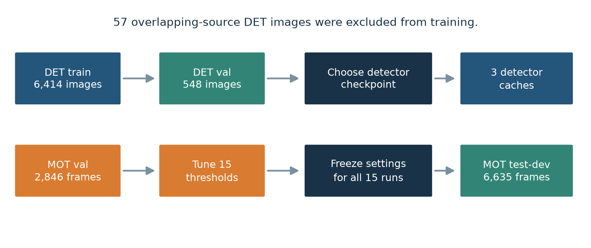
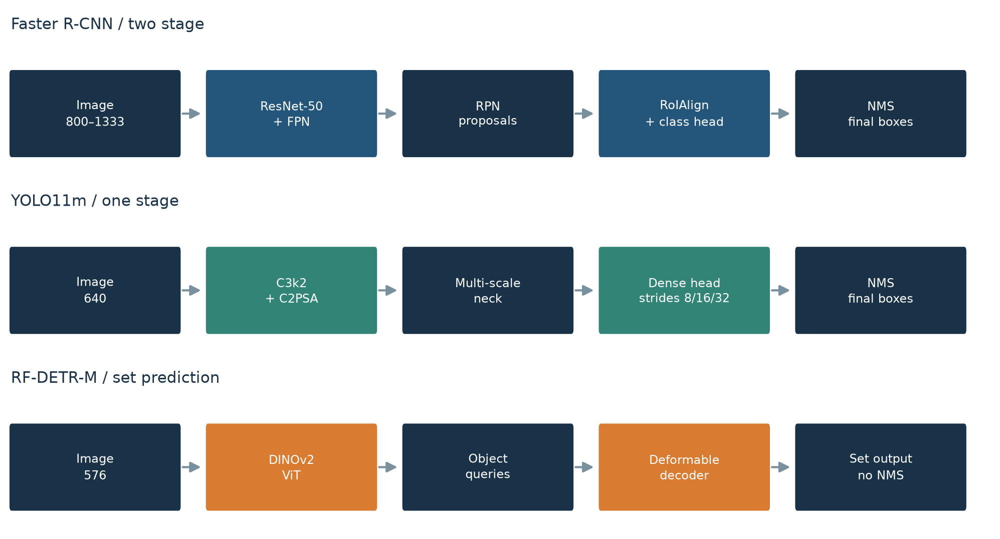
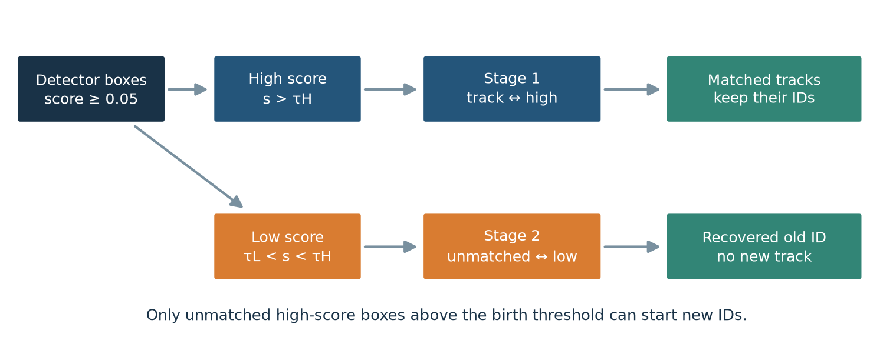
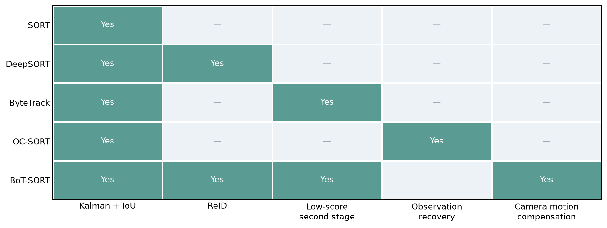
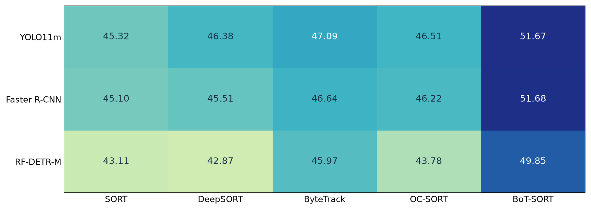
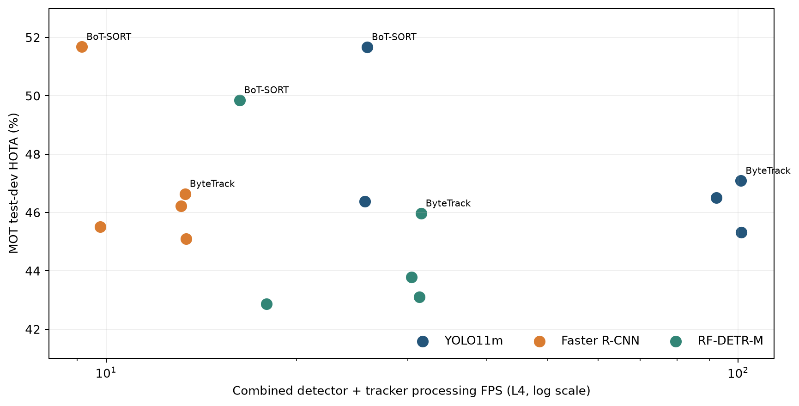

# UAV Multi-Object Tracking: English Oral Examination Guide

This guide describes the actual project protocol, the mathematical structure of its detectors and trackers, and the measured results. It distinguishes equations defining an algorithm from empirical claims about this particular experiment. A mathematical derivation explains why an update or objective has its stated form; it cannot prove that a learned network will generalize to unseen drone footage.

## 1. A two-minute project explanation

The project studies tracking by detection on UAV video. For each frame, a detector predicts boxes, class labels, and confidence scores. A tracker connects boxes across frames and assigns persistent IDs. We compare three detection families: two-stage Faster R-CNN ResNet-50 FPN v2, one-stage YOLO11m, and transformer-based RF-DETR Medium. Each is paired with SORT, DeepSORT, ByteTrack, OC-SORT, and BoT-SORT, giving 15 combinations.

The detectors in the main experiment were fine-tuned on 6,414 cleaned VisDrone2019-DET training images. DET validation, containing 548 images, selected detector checkpoints. MOT validation, containing 2,846 frames, selected tracking thresholds. MOT test-dev, containing 6,635 frames, was reserved for final reporting. Detectors learn ten object classes, while the reported MOT evaluation covers five: pedestrian, car, van, truck, and bus.

On MOT test-dev, BoT-SORT achieved the highest HOTA for all three detectors: 51.67 with YOLO11m, 51.68 with Faster R-CNN, and 49.85 with RF-DETR-M. The 0.01-point difference between the first two is too small to support a general ranking. YOLO11m + ByteTrack reached 47.09 HOTA at 101.0 processing FPS on an NVIDIA L4; YOLO11m + BoT-SORT reached 51.67 HOTA at 25.9 FPS. Ground-truth-box oracle runs achieved 84.30–94.93 HOTA.

The large oracle gap points to detection as a major bottleneck, although detection and association errors interact.

## 2. The exact task and notation

For image $I_t$ at time $t$, a detector returns $D_t=\{d_{tj}\}_{j=1}^{n_t}$ with $d_{tj}=(b_{tj},c_{tj},s_{tj})$. Here $b$ is a bounding box, $c$ is an object class, and $s$ is a detector score. A tracker returns $T_t=\{(b_{ti},c_{ti},q_{ti})\}$, where $q$ is the track ID. Tracking quality concerns the consistency of $q$ through time as well as box accuracy.

A track ID is local to a sequence or camera session. It is not a person's legal identity or a license-plate number. A detector can have good per-frame AP while producing intermittent boxes and poor MOT. Conversely, a tracker cannot reconstruct visual evidence that has disappeared from the detector input. Tracking algorithms may bridge short gaps by prediction, but predictions without observation are uncertain.

The five evaluated classes are VisDrone category IDs $\{1,4,5,6,9\}$. Motorcycle or “motor” is category 10 and is included in detector training but not in the reported five-class tracking metric. Detector comparisons are comparisons of complete configurations: image size, architecture, optimization, and postprocessing differ. They are not a controlled causal test of architecture alone.

## 3. Data provenance, splits, and distribution shift

VisDrone2019-MOT has 80 sequences, 33,682 frames, 1,527,447 labeled boxes across classes 1–10, and 10,393 ground-truth trajectories. MOT train has 56 sequences, 24,201 frames, 1,105,516 boxes, and 7,342 tracks. MOT val has 7 sequences, 2,846 frames, 114,132 boxes, and 758 tracks. MOT test-dev has 17 sequences, 6,635 frames, 307,799 boxes, and 2,293 tracks. Mean density is 45.7, 40.1, and 46.4 boxes per frame, respectively.

The main detector training source is VisDrone2019-DET, not MOT train. Fifty-seven DET training images share original video IDs with MOT val or test-dev and were removed: 45 overlap val and 12 overlap test-dev. This leaves 6,414 DET train images. DET val has 548 images.

DET test-dev has 1,610 still images and is used only in supplementary detection experiments. “DET test-dev” and “MOT test-dev” are distinct datasets; their AP values cannot be substituted for one another.

An early MOT training variant retained odd-numbered frames, a stride of two. It gave 12,114 train frames and 553,391 boxes while preserving 99.6% of tracks. That is an exploratory variant, not the training set behind the main 3-by-5 matrix. MOT val and test-dev always retain every frame because continuity matters for tracking.

On a diagnostic RF-DETR run trained with MOT frames, train mAP rose from 39.12 to 58.02 between epochs 1 and 16, while validation mAP fell from 23.32 to 17.79. The result is evidence of scene overfitting in that experiment and motivated the more diverse DET training source.

The ten train-MOT class shares are: car 45.7%, pedestrian 21.2%, motor 9.3%, people 8.5%, van 4.2%, bicycle 3.6%, truck 2.8%, tricycle 2.6%, awning-tricycle 1.2%, and bus 0.9%. Car has 505,301 boxes while bus has 9,653, about a 52-fold imbalance. The splits also differ: pedestrian is 28.4% on val and 34.5% on test-dev; car is 27.9% and 32.4%.

Rare-class AP is potentially unstable because a small number of sequences can dominate it.

Under the COCO area convention, “small” means $A<32^2$ pixels squared, “medium” means $32^2\le A<96^2$, and “large” means $A\ge96^2$. Small-box shares are 24.9% on MOT train, 19.2% on val, and 47.8% on test-dev. Thus the final split has almost twice the small-object share of train. At a simulated longest-side resize of 576 pixels, 27.9% of train boxes and 24.3% of test-dev boxes have a shorter side below eight pixels.

At 1,024 pixels, these shares drop to 4.3% and 4.7%. These are dataset geometry statistics, not measured model recall.

Occlusion matters: train labels are 54.3% unoccluded, 40.3% partly occluded, and 5.3% heavily occluded; test-dev is 47.9%, 42.6%, and 9.5%. The median same-object adjacent-frame IoU is approximately 0.897 on train, 0.873 on val, and 0.875 on test-dev. Only 1.6%, 4.2%, and 3.2% of adjacent same-object pairs fall below IoU 0.3. Geometric association is therefore plausible when detections are continuous, but moving cameras and missing boxes cause hard exceptions.

The label format is `frame, track_id, x, y, width, height, score, class, truncation, occlusion`. Class 0 is an ignored region; 11 is “others”; classes 1–10 are trained objects. Ground-truth score is an evaluation flag, not a calibrated probability. Thirty-four source boxes extend one or two pixels beyond image boundaries and are clipped. Ignored regions indicate incomplete annotation, not background.

Evaluation removes GT and predicted boxes with more than half their area in the union of ignored regions.

## 4. Preprocessing geometry and its mathematical consequences

For a source box in top-left format $(x,y,w,h)$, define $x_1=x$, $y_1=y$, $x_2=x+w$, and $y_2=y+h$. Clipping to image width $W$ and height $H$ gives $x'_1=\max(0,\min(W,x_1))$ and $x'_2=\max(0,\min(W,x_2))$, with analogous expressions for $y$. Retain the box only when $x'_2-x'_1\ge1$ and $y'_2-y'_1\ge1$.

YOLO labels use normalized center format: $c_x=(x'_1+x'_2)/(2W)$, $c_y=(y'_1+y'_2)/(2H)$, $w_n=(x'_2-x'_1)/W$, $h_n=(y'_2-y'_1)/H$. YOLO and RF-DETR use internal class IDs 0–9, so their cached class is `native_id + 1`; Faster R-CNN uses category 0 for background and 1–10 for objects. A one-class offset would invalidate class-aware tracking even if boxes appeared correct.

For two axis-aligned boxes $A$ and $B$, let $w_I=\max(0,\min(x^A_2,x^B_2)-\max(x^A_1,x^B_1))$ and similarly $h_I$. Then $I=w_Ih_I$, $U=|A|+|B|-I$, and $\operatorname{IoU}(A,B)=I/U$ when $U>0$. The subtraction of $I$ in $U$ follows inclusion–exclusion: otherwise the intersection would be counted twice. For two 10-by-10 boxes shifted two pixels in both coordinates, $I=8\cdot8=64$, $U=100+100-64=136$, and IoU is approximately 0.471. Tiny boxes are therefore especially sensitive to coordinate error.

The same cleaned annotations produce COCO JSON, RF-DETR COCO-style directories, YOLO files, and MOTChallenge files. Detection caches use original-image pixel coordinates and retain predictions down to score 0.05. All five trackers for one detector read the same cache. Tracker state is reset between sequences; empty frames still advance the tracker. This design avoids inference randomness and inconsistent class conversion across tracker comparisons.

{width=6.2in}

## 5. Detection evaluation: precision, recall, AP, and mAP

At a chosen IoU and score threshold, true positives are correctly matched predictions, false positives are unmatched predictions, and false negatives are unmatched ground-truth objects. Precision and recall are

$$P=\frac{TP}{TP+FP},\qquad R=\frac{TP}{TP+FN}.$$

The precision–recall curve is obtained by sorting predictions by decreasing confidence and admitting them one by one. Average precision is the area under its interpolated precision envelope: $AP=\int_0^1 P_{\mathrm{interp}}(r)\,dr$, approximated in the COCO protocol at discrete recall points. AP is a ranking metric over thresholds, not precision at a single operating score.

The project reports $\mathrm{mAP}_{50:95}$ across ten IoU thresholds 0.50, 0.55, …, 0.95 and ten classes. The category mean is a macro mean, so bus contributes one tenth even though it has relatively few labels. AP-small/medium/large filter ground-truth objects by original-image area. The common evaluation script uses at most 500 detections per image for AP/AR because VisDrone frames can be crowded.

The main variant filters ignored regions on both GT and predictions. At a separate fixed score of 0.5, it also reports micro precision, recall, and F1.

The maximum number of predictions used by evaluation must be distinguished from the cache threshold and the model's own `max_det`. A cache made at score 0.05 can be filtered later. A cache made at score 0.5 cannot recover lower-scoring detections required by ByteTrack's second stage.

## 6. Shared detector concepts: backbone, feature pyramid, losses, and NMS

A convolutional backbone maps an image to hierarchical feature maps $C_l$. A residual block computes $y=x+F(x;\theta)$. Its derivative is $\partial y/\partial x=I+\partial F/\partial x$; the identity term gives a direct gradient path, explaining why residual networks can train at substantial depth. This is a mechanism, not a guarantee that gradients never vanish in a complete network.

A feature pyramid combines semantic information from deeper maps with spatial detail from shallower maps. In a simple top-down form, $P_l=\operatorname{Conv}_{3\times3}(L_l(C_l)+\operatorname{Upsample}(P_{l+1}))$, where $L_l$ is a lateral projection. This gives the detector several effective receptive fields and scales. Downsampling still costs resolution: a 12-pixel object becomes about 1.5 feature cells at stride eight, before any interpolation or context is considered.

Non-maximum suppression sorts boxes by score, keeps the highest, and suppresses same-class boxes with IoU over a threshold. Its purpose is to remove duplicate hypotheses. In dense scenes, two real objects can overlap heavily, so too aggressive an NMS threshold can suppress a true object. Faster R-CNN and YOLO use NMS in their inference pipeline. RF-DETR's set-prediction design does not require standard NMS.

## 7. Faster R-CNN ResNet-50 FPN v2: stages and derivations

The first stage uses ResNet-50 with FPN and a region proposal network (RPN). At each feature-map location and anchor, the RPN predicts an objectness logit and four box offsets. An anchor $a=(x_a,y_a,w_a,h_a)$ and target box $g=(x_g,y_g,w_g,h_g)$ can be related by

$$t_x=\frac{x_g-x_a}{w_a},\quad t_y=\frac{y_g-y_a}{h_a},\quad t_w=\log\frac{w_g}{w_a},\quad t_h=\log\frac{h_g}{h_a}.$$

The inverse decoding is $x=x_a+t_xw_a$, $y=y_a+t_yh_a$, $w=w_a e^{t_w}$, and $h=h_a e^{t_h}$. Translation is scaled by anchor size, while width/height are represented in log space to keep multiplicative size changes approximately additive. Objectness and box regression produce proposal candidates. Proposal NMS and selection limit the number passed to the second stage.

The second stage assigns proposals to FPN levels, uses RoIAlign to sample a fixed-size feature grid, then predicts class logits and another box refinement. RoIAlign interpolates feature values at fractional coordinates; unlike quantized RoI pooling, it avoids a coordinate-rounding shift that is especially costly for small objects. The classification head has 11 outputs: background plus ten VisDrone classes.

The training objective has four conceptually distinct terms:

$$L=L_{\mathrm{RPN,obj}}+\lambda_1L_{\mathrm{RPN,box}}+L_{\mathrm{RoI,cls}}+\lambda_2L_{\mathrm{RoI,box}}.$$

Classification is commonly cross-entropy; box terms commonly use Smooth L1 or the loss specified by the installed torchvision implementation. Smooth L1 is quadratic for small residuals and linear for large ones: $\ell_\beta(r)=r^2/(2\beta)$ for $|r|<\beta$, otherwise $|r|-\beta/2$. The quadratic region provides a smooth local gradient; the linear tail limits the influence of large box errors.

The project retains aspect ratio, resizing the short image side to 800 pixels while limiting the long side to 1,333. It fine-tuned COCO weights on DET train using batch 4, SGD learning rate 0.005, momentum 0.9, weight decay $10^{-4}$, AMP, and seed 0. The configuration specified 24 epochs with learning-rate reductions after epochs 16 and 22; the selected DET-val checkpoint was epoch 17.

Measured detector speed was 13.76 FPS on L4, with 43.3 million parameters and about 745.5 GFLOPs/frame under the project's input-distribution and FLOP convention.

## 8. YOLO11m: direct multi-scale prediction and DFL

YOLO11m is a one-stage detector. Its backbone includes C3k2 and C2PSA blocks; a multi-scale neck combines feature maps, and the head predicts at strides 8, 16, and 32. “One stage” means it does not first generate a separate proposal set and then classify pooled regions.

Its head is anchor-free in the sense that it does not regress from a manually enumerated set of anchor box shapes; grid points and feature maps act as prediction references.

For grid reference point $(x_p,y_p)$, an illustrative distance representation predicts left, top, right, and bottom distances $(l,t,r,b)$, decoding to $(x_p-l,y_p-t,x_p+r,y_p+b)$. The head outputs distributions over distance bins rather than only one scalar per side. If probabilities over neighboring integer bins $k$ and $k+1$ are $p_k$ and $p_{k+1}$ for target distance $y\in[k,k+1]$, Distribution Focal Loss uses the target's linear interpolation weights:

$$L_{\mathrm{DFL}}(y)=-\big[(k+1-y)\log p_k+(y-k)\log p_{k+1}\big].$$

The weights sum to one and place the expected target at $y$: $(k+1-y)k+(y-k)(k+1)=y$. This provides supervision between discrete bins. The full detection objective combines classification and localization terms, including an IoU-based box loss and DFL. It is important not to claim that DFL alone measures the final bounding-box overlap.

For a single binary class target $y\in\{0,1\}$ and predicted probability $p=\sigma(z)$, binary cross-entropy is $L=-y\log p-(1-y)\log(1-p)$. Differentiating through the sigmoid gives $\partial L/\partial z=p-y$. The expression explains why underconfident positives push their logits upward and confident false positives push downward. Modern YOLO training adds assignment and localization machinery around this basic classification gradient; the simple derivative is not the entire detector loss.

The project fine-tuned COCO-pretrained `yolo11m.pt` on DET train at 640 input size for 80 epochs, batch 16, SGD initial learning rate 0.01, cosine schedule, three warmup epochs, weight decay $5\times10^{-4}$, AMP, seed 0, and early-stopping patience 20. Mosaic augmentation was disabled for the final ten epochs. The selected checkpoint was epoch 60. Inference uses class-wise NMS with IoU threshold 0.7 and allows up to 1,000 detections when caching.

The model has 20.1 million parameters, about 40.7 GFLOPs/frame, and 118.27 detector FPS on L4.

## 9. RF-DETR Medium: attention, set prediction, and Hungarian loss

RF-DETR-M uses a DINOv2-pretrained vision transformer backbone, projection of image features, learned object queries, and a decoder with deformable attention. A vision transformer embeds image patches and mixes information using attention. For query $Q$, keys $K$, values $V$, and feature dimension $d$, scaled dot-product attention is

$$\operatorname{Attn}(Q,K,V)=\operatorname{softmax}\left(\frac{QK^\top}{\sqrt d}\right)V.$$

The factor $1/\sqrt d$ controls logit scale: if independent query and key components have unit variance, their dot product has variance proportional to $d$, so division yields approximately dimension-independent variance. This is a statistical motivation, not a proof that all learned attention logits have unit variance.

In a deformable attention layer, each query samples a small number of learned offsets around reference points on one or more feature maps. A schematic formula is $z_q=\sum_{l,k}a_{qlk}\,W_lF_l(p_{ql}+\Delta p_{qlk})$, where $l$ indexes feature levels, $k$ sampling points, $a$ are normalized attention weights, and $F_l$ is interpolated at non-integer positions. Compared with dense attention over every image location, restricting sampling can reduce computation and focus on relevant locations.

The decoder returns a fixed-size set of object hypotheses. During training, a bipartite assignment $\pi$ matches target objects to unique query indices by minimizing a sum of classification and box costs. For target $i$ and query $j$, a schematic cost is

$$C_{ij}=\lambda_{\mathrm{cls}}C_{\mathrm{cls}}(i,j)+\lambda_1\|b_i-\hat b_j\|_1+\lambda_G[1-\operatorname{GIoU}(b_i,\hat b_j)].$$

Then $\pi^*=\arg\min_{\pi\in\mathcal{P}}\sum_i C_{i,\pi(i)}$, with $\mathcal{P}$ the valid one-to-one assignments. Matched queries receive class and box supervision; unmatched queries receive no-object supervision. Auxiliary decoder outputs can also be supervised. A one-to-one assignment means two queries cannot both be assigned to the same GT in that training step. This discourages duplicate final predictions, explaining why standard NMS is unnecessary.

It does not logically guarantee zero duplicate boxes or zero false positives at inference.

GIoU extends IoU to non-overlapping boxes. If $C$ is the smallest enclosing box of $A\cup B$, then $\operatorname{GIoU}(A,B)=\operatorname{IoU}(A,B)-(|C|-|A\cup B|)/|C|$. For boxes with zero intersection, ordinary IoU is zero over a broad range of positions, while the enclosure penalty varies with their separation and can supply a localization gradient. L1 directly penalizes coordinate distance; classification distinguishes foreground classes from no-object.

The configured input size is 576. The patch scale is 16 pixels, but a sub-patch object is not mathematically invisible: patch embeddings, surrounding context, interpolation, and multi-scale features may still convey information. The main run used 6,414 DET training images, 548 DET validation images, at most 40 epochs, early-stopping patience eight, AdamW learning rate $10^{-4}$, encoder learning rate $1.5\times10^{-4}$, weight decay $10^{-4}$, one warmup epoch, and cosine scheduling.

Batch was eight per GPU on two L4 GPUs, with no gradient accumulation, for effective batch 16. The report's training figure marks epoch 23 as the selected checkpoint; the narrative table does not independently confirm the epoch. The model has 33.4 million parameters, about 78.4 GFLOPs/frame, and 32.82 detector FPS on L4.

RF-DETR queries are object hypotheses within a frame, not persistent temporal identities. The project therefore still runs an external tracker. The published RF-DETR research discusses architecture search; this project fine-tuned the supplied Medium configuration and did not rerun that search.

{width=6.2in}

## 10. Optimization: why pretraining, SGD, AdamW, warmup, and cosine schedules matter

Fine-tuning starts from COCO-pretrained detector weights, while the final class head is adapted to ten VisDrone classes. Pretraining provides transferable visual features; it does not make the detector automatically calibrated for drone imagery. A detector checkpoint is selected by DET-val performance, not by looking at MOT test-dev.

For SGD with momentum, an idealized update is $v_{k+1}=\mu v_k+\nabla_\theta L(\theta_k)$ and $\theta_{k+1}=\theta_k-\eta_k v_{k+1}$, with weight decay applied according to the optimizer implementation. Momentum accumulates consistent gradient directions and smooths noisy batch estimates. YOLO and Faster R-CNN used SGD in the reported configurations.

AdamW uses moving estimates $m_k=\beta_1m_{k-1}+(1-\beta_1)g_k$ and $v_k=\beta_2v_{k-1}+(1-\beta_2)g_k^2$. After bias correction, its decoupled-weight-decay update has the form $\theta_{k+1}=\theta_k-\eta_k\hat m_k/(\sqrt{\hat v_k}+\epsilon)-\eta_k\lambda\theta_k$. The final term is separate from the loss-gradient normalization. RF-DETR used AdamW; it assigned a distinct encoder learning rate.

A cosine learning-rate schedule can be written $\eta(e)=\eta_{\min}+\tfrac12(\eta_{\max}-\eta_{\min})(1+\cos(\pi e/E))$ after warmup. Warmup gradually raises the learning rate during early updates, helpful when a newly initialized class head and pretrained backbone have different starting conditions. AMP uses lower precision for selected operations while preserving numerically sensitive operations at suitable precision; it changes compute/memory use, not the target labels or metric definitions.

## 11. Kalman filtering: complete predict and update derivation

Trackers model a latent box state $x_t$ and observation $z_t$. The linear Gaussian model is $x_t=F x_{t-1}+w_t$ with $w_t\sim\mathcal{N}(0,Q)$ and $z_t=H x_t+v_t$ with $v_t\sim\mathcal{N}(0,R)$. Assuming a Gaussian posterior at the previous frame, $x_{t-1}\mid z_{1:t-1}\sim\mathcal{N}(m_{t-1},P_{t-1})$, an affine transform of a Gaussian remains Gaussian. Thus the prediction is

$$m^-_t=F m_{t-1},\qquad P^-_t=F P_{t-1}F^\top+Q.$$

The covariance formula follows because $\operatorname{Cov}(Fx+w)=F\operatorname{Cov}(x)F^\top+\operatorname{Cov}(w)$ when state and process noise are independent. Prediction increases uncertainty through $Q$. A tracker can propagate a track without a detection, but its location becomes less certain.

For an observed detection, the innovation is $y_t=z_t-Hm^-_t$ and its covariance is $S_t=HP^-_tH^\top+R$. The state and observation are jointly Gaussian with covariance $\operatorname{Cov}(x_t,z_t)=P^-_tH^\top$. Conditioning a joint Gaussian, equivalently completing the square in the product of prior and likelihood, gives

$$K_t=P^-_tH^\top S_t^{-1},\quad m_t=m^-_t+K_ty_t,\quad P_t=P^-_t-K_tS_tK_t^\top.$$

The numerically transparent Joseph covariance form is $P_t=(I-KH)P^-_t(I-KH)^\top+KRK^\top$. Algebraically, for the optimal $K$, it equals the shorter expression above in exact arithmetic. The code uses a linear solve rather than explicitly forming $S^{-1}$, which is preferable for numerical stability.

A one-dimensional example makes the gain intuitive. Suppose the predicted center is 100 pixels with variance 25 and a new detection says 110 pixels with measurement variance 9. Then $K=25/(25+9)=0.7353$, the updated center is $100+0.7353(10)=107.35$, and posterior variance is $25-25^2/34\approx6.62$. The estimate moves toward the more precise measurement but does not jump all the way to it.

When detection noise is large, $K$ is smaller; when prediction uncertainty is large, $K$ is larger.

The squared Mahalanobis distance $d_M^2=(z-Hm^-)^\top S^{-1}(z-Hm^-)$ measures how surprising a detection is under the predicted measurement distribution. Whitening by a Cholesky factor $S=LL^\top$ gives $d_M^2=\|L^{-1}(z-Hm^-)\|_2^2$. Under the assumed Gaussian model and a correct four-dimensional observation, it follows a $\chi^2_4$ distribution; the 95% quantile is about 9.4877. DeepSORT uses this value to gate implausible matches. If the model is miscalibrated, the nominal 95% interpretation may not hold exactly.

The repository implements three state parameterizations. SORT and OC-SORT use $[u,v,s,r,\dot u,\dot v,\dot s]$ with center $(u,v)$, area $s$, and aspect ratio $r=w/h$. DeepSORT and ByteTrack use eight dimensions: $[u,v,a,h,\dot u,\dot v,\dot a,\dot h]$, where $a=w/h$. BoT-SORT uses $[u,v,w,h,\dot u,\dot v,\dot w,\dot h]$. In all three, position components and velocities are linked by a constant-velocity transition with one-frame time step.

The noise matrices differ by model; the eight-state versions scale positional noise with box size.

## 12. Assignment and the Hungarian algorithm

Given $n$ tracks and $m$ detections, define a cost matrix $C\in\mathbb{R}^{n\times m}$. Binary variable $x_{ij}=1$ indicates that track $i$ takes detection $j$. Minimum-cost assignment solves $\min_x\sum_{i,j}C_{ij}x_{ij}$ subject to $\sum_jx_{ij}\le1$, $\sum_ix_{ij}\le1$, and $x_{ij}\in\{0,1\}$. The inequalities allow unmatched tracks and detections. The Hungarian algorithm finds a global one-to-one optimum for the assignment subproblem, unlike greedy nearest-neighbor matching. A match threshold then rejects invalid or excessively costly pairs.

The simplest geometry cost is $C_{ij}=1-\operatorname{IoU}(\hat b_i,d_j)$. For IoU threshold 0.3, accept only costs at most 0.7. Class-aware tracking creates separate matrices for the five evaluated classes, so a car cannot match a pedestrian even if boxes overlap. In the project code, impossible costs are clipped just beyond the threshold before the assignment step, then pairs above the true threshold are rejected.

This prevents an impossible edge from distorting the remaining feasible solution.

The assignment optimum is conditional on the chosen costs. It does not guarantee that the real-world identities are correct. Two crossing cars can have nearly identical geometry and appearance. Track management, score filtering, and camera compensation determine the quality of the cost matrix and the candidate set.

The optimality logic of Hungarian assignment can be explained through linear-programming duality. For a square assignment problem with equality constraints, the primal minimizes $\sum_{ij}C_{ij}x_{ij}$. Its dual maximizes $\sum_i u_i+\sum_j v_j$ subject to $u_i+v_j\le C_{ij}$. Any feasible dual gives a lower bound on every feasible assignment: $\sum_{ij}C_{ij}x_{ij}\ge\sum_{ij}(u_i+v_j)x_{ij}=\sum_i u_i+\sum_j v_j$.

If an assignment uses only tight edges satisfying $C_{ij}=u_i+v_j$ and covers each row and column once, its cost equals that lower bound. It is therefore globally optimal. Hungarian row/column reductions and augmenting paths construct such a tight-edge matching. Practical MOT uses rectangular matrices, thresholds, and unmatched elements, but this dual argument explains the global-minimum claim for the core assignment subproblem.

## 13. SORT: minimal tracking by detection

SORT predicts each track with the seven-state Kalman filter, computes predicted-box versus detection IoU, runs Hungarian assignment, updates matched tracks, creates tentative tracks for unmatched detections, and ages unmatched tracks. Its configured `max_age` is 30 frames, `min_hits` is three, and IoU threshold is 0.3; default detection threshold is 0.4. It has no appearance embedding and no global camera motion compensation.

The state-to-box decoding follows $s=wh$ and $r=w/h$. Solving gives $w=\sqrt{sr}$ and $h=s/w$, then $x_1=u-w/2$, $y_1=v-h/2$, $x_2=u+w/2$, $y_2=v+h/2$. This derivation also shows why predicted $s$ and $r$ must stay positive; the implementation guards against nonpositive area before prediction and decoding.

SORT is useful as a fast baseline because its sources of improvement and failure are clear. It can preserve IDs when adjacent-frame overlap is high. It is vulnerable when the camera moves abruptly, detections disappear, or objects cross and their IoU assignments swap.

## 14. DeepSORT: Mahalanobis gating, ReID, and matching cascade

DeepSORT adds appearance embeddings extracted by OSNet-x0.25 pretrained on MSMT17. If embeddings $f_i$ and $g_j$ are L2-normalized, their cosine distance is $d_{ij}^{\cos}=1-f_i^\top g_j$. A track keeps up to 100 previous embeddings, and the repository uses the nearest-neighbor gallery cost $\min_{f\in G_i}(1-f^\top g_j)$. This is not OCR; it is a learned visual similarity measure.

The algorithm first gates each candidate by squared Mahalanobis distance, rejecting values above 9.4877 in its four-dimensional box-observation space. It then associates confirmed tracks in a cascade ordered by time since last observation, with the most recently seen tracks first. Within each cascade step, it solves an assignment using appearance cost limited by `max_cosine_distance=0.2`.

Remaining tentative tracks and recently unmatched confirmed tracks receive an IoU-based second chance, with `max_iou_distance=0.7`.

Tracks begin tentative; `n_init=3` observations confirm them. A tentative miss deletes the track, while a confirmed track can survive up to `max_age=30` missed frames. Default detection threshold is 0.4. The actual encoder comes from boxmot weights, but the tracking logic is implemented in the repository. Appearance can help after occlusion, yet the pedestrian-oriented source domain and tiny aerial crops can make it unreliable for vehicles.

The empirical results do not support claiming that ReID always improves HOTA.

## 15. ByteTrack: a derivation of the two-score association

Let high detections satisfy $s>\tau_H$ and low detections satisfy $\tau_L<s<\tau_H$. The default project settings are $\tau_H=0.5$, $\tau_L=0.1$, `new_track_thresh=0.6`, `match_thresh=0.8`, and `track_buffer=30`. Score-fused first-stage cost is $C_{ij}^{(1)}=1-s_j\operatorname{IoU}(\hat b_i,d_j)$. Because $s_j\in[0,1]$, this cost is at least the plain IoU cost $1-\operatorname{IoU}$; a lower score makes the match less attractive even at the same overlap.

Stage one predicts confirmed and lost tracks, then assigns them to high-score detections using that cost. Stage two considers still-unmatched currently tracked objects against low-score boxes using plain $1-\operatorname{IoU}$, with a cost threshold 0.5. Lost tracks are not promoted by arbitrary low-score boxes in this implementation. Unconfirmed tracks have a separate high-score matching stage with threshold 0.7. Remaining high-score boxes can start a track only when $s\ge\tau_{\mathrm{new}}$.

Low-score boxes never start new tracks. The system also removes near-duplicate active/lost tracks based on IoU and track age.

This asymmetric rule is rational under a simple risk argument. A low-score detection at the predicted location of an existing track has supporting temporal evidence, but the same isolated box has weak evidence for a new identity. The rule is a heuristic, not a Bayesian proof that all low-score matches are true.

In the validation threshold sweep, the high threshold $\tau$ changes and the new-track threshold follows approximately $\min(\tau+0.1,0.95)$, bounded below by $\tau$; the low threshold remains 0.1. Thus a threshold sweep changes both first-stage association and track birth.

ByteTrack uses the eight-state center/aspect/height Kalman model. It needs no appearance model, which contributes to its speed. YOLO11m + ByteTrack is the high-throughput candidate in the project.

For an oral-exam example, assume an existing track has predicted IoU 0.6 with a new box whose score falls from 0.7 to 0.2 during occlusion. The box belongs to the high group before occlusion and to the low group afterward. In stage two, its geometric cost is $1-0.6=0.4$, below the implementation's 0.5 limit, so it can continue the old ID.

An isolated box at score 0.2 cannot start a new track because it fails the new-track threshold. This is exactly the asymmetric temporal evidence that SORT does not exploit.

{width=6.2in}

## 16. OC-SORT: observation-centered motion, recovery, and replay

OC-SORT uses the SORT-style seven-state filter but supplements predictions with observations. Its three named ideas are OCM (observation-centric momentum), OCR (observation-centric recovery), and ORU (observation-centric re-update). The configured values are detection threshold 0.5, `max_age=30`, `min_hits=3`, IoU threshold 0.3, observation lag `delta_t=3`, and momentum weight `inertia=0.2`.

For OCM, estimate a direction vector from the last observed box and an earlier observed box, normalized to unit length. For a proposed match, compute the direction from a reference observed center to the detection center. Their cosine similarity indicates directional agreement. The implementation adds a bounded direction score, weighted by inertia and detection confidence, to IoU before assignment.

Direction matters only when there are observations from which to estimate it; a predicted path alone is not treated as exact evidence.

OCR revisits unmatched tracks using their last observed box rather than only the Kalman-predicted box. This can recover a track if a long prediction drifted away but a new detection overlaps the last reliable observation. ORU handles a recovered track after a gap.

If the last real observation is $z_a$ at time $a$ and the next is $z_b$ at $b$, it constructs virtual intermediate centers $c_k=c_a+\frac{k-a}{b-a}(c_b-c_a)$ and interpolated widths/heights. It restores the saved filter after the previous observation and replays virtual updates and predictions along the gap before the actual new observation. This is a linear interpolation assumption; it is not a physical reconstruction of the missing trajectory.

The oracle experiment is instructive: OC-SORT obtains 89.99 HOTA using GT boxes, better than ByteTrack's 86.48, yet ByteTrack beats OC-SORT with all three real detector caches. A tracker ranking depends on input error patterns, not only the method's ideal-input potential.

## 17. BoT-SORT: camera motion, appearance, and score fusion

BoT-SORT inherits the two-stage lifecycle from ByteTrack but changes its state representation and first-stage cost. It uses the eight-state center/width/height model, OSNet appearance embeddings, and sparse-optical-flow global motion compensation (GMC). The default settings retain high/low/new thresholds 0.5/0.1/0.6, match cost threshold 0.8, buffer 30, proximity threshold 0.5, appearance threshold 0.25, and GMC mode `sof`.

The code detects up to 1,000 corners in the previous grayscale frame, tracks them with pyramidal Lucas–Kanade optical flow, and fits a partial affine transform by RANSAC. In homogeneous notation, a point changes approximately as $p'=Ap+t$, where $A$ is a 2-by-2 rotation/scale component and $t$ is translation. RANSAC selects a transform supported by many feature correspondences while reducing outlier influence.

If too few points exist or fitting fails, the implementation uses identity motion.

If $M$ is the block-diagonal state transform induced by $A$, the track Gaussian is warped as $m'=Mm+\tilde t$ and $P'=MPM^\top$. This is the same affine covariance rule used in Kalman prediction. It can correct image-plane camera motion before track-to-detection matching. It does not by itself establish world coordinates or make a traffic stop line stationary in moving UAV imagery.

For the first-stage match, let $d_I=1-\operatorname{IoU}$ and $d_E$ be cosine embedding distance. The code computes fused geometric cost $d_F=1-s_j\operatorname{IoU}$. Appearance cost is $d_A=d_E/2$, but it is set to 1 if $d_A$ exceeds appearance threshold 0.25 or if $d_I$ exceeds proximity threshold 0.5. The final cost is $C_{ij}=\min(d_F,d_A)$ when appearance is available, otherwise $C_{ij}=d_F$. An exponential moving average updates a track feature: $f_t\propto0.9f_{t-1}+0.1g_t$, then L2 normalizes it.

The second low-score association remains geometric, as in ByteTrack.

BoT-SORT's HOTA improvement over ByteTrack is consistent with benefits from camera compensation and appearance, but the two methods also have different Kalman states and costs. Without experiments disabling GMC and ReID separately, the project cannot assign a causal fraction of the gain to either component.

{width=6.2in}

## 18. Tracking metrics: HOTA, DetA, AssA, IDF1, and MOTA

For a localization threshold $\alpha$, HOTA separates detection accuracy and association accuracy. Its detection term is $\mathrm{DetA}_\alpha=TP/(TP+FP+FN)$. This differs from precision's denominator. For each matched detection pair $c$, association quality compares correctly associated true positives $TPA(c)$ against false-negative and false-positive associations: $A(c)=TPA(c)/(TPA(c)+FNA(c)+FPA(c))$. AssA is the average of $A(c)$ over matched pairs. Then

$$\mathrm{HOTA}_\alpha=\sqrt{\mathrm{DetA}_\alpha\mathrm{AssA}_\alpha},\qquad \mathrm{HOTA}=\frac1{19}\sum_{\alpha\in\{0.05,0.10,\ldots,0.95\}}\mathrm{HOTA}_\alpha.$$

The geometric mean makes HOTA small if either detection or association is poor. For example, if DetA is 0.25 and AssA is 0.64, HOTA at that threshold is $\sqrt{0.16}=0.40$. Doubling one component does not linearly double HOTA. Reported class-averaged HOTA cannot generally be reconstructed by taking the square root of the product of separately averaged DetA and AssA, because averaging and nonlinear transformation do not commute.

Association quality is not simply one minus the ID-switch rate. Consider a GT trajectory visible for 100 frames. A predicted identity that covers 50 correct frames, disappears, and is replaced by another ID for the remaining 50 can have only one switch event, yet each predicted fragment has limited full-trajectory association. HOTA's association accounting and IDF1 therefore reveal damage that an IDSW count alone may understate.

Conversely, a few very short false tracks can increase FP without producing any switch. This is why several metrics are reported together.

MOTA is $1-(FN+FP+IDSW)/N_{GT}$ after summing across frames, where $N_{GT}$ is the total number of annotated object instances. It can be negative when the error count exceeds the GT count. MOTA is strongly driven by detection FP and FN. ID precision is $IDTP/(IDTP+IDFP)$, ID recall is $IDTP/(IDTP+IDFN)$, and their harmonic mean is

$$\mathrm{IDF1}=\frac{2IDTP}{2IDTP+IDFP+IDFN}.$$

IDF1 evaluates globally consistent identity assignments. IDSW counts a switch of the predicted ID attached to a GT trajectory; fragmentation records interruptions. Mostly tracked (MT) means coverage of at least 80% of a GT trajectory; mostly lost (ML) means at most 20%. LocA and MOTP address localization quality of matched boxes. None of these single metrics fully replaces the others.

The evaluator runs TrackEval with HOTA, CLEAR, and Identity metrics. It evaluates each of the five classes separately and combines sequences within a class. Percent-type metrics are then macro-averaged across five classes; count metrics such as IDSW, FP, and FN are summed. Ground-truth and tracker boxes more than 50% inside the union of ignored regions are removed before evaluation.

The reported “overall HOTA” is not an average of per-frame HOTA values.

## 19. Oracle experiment and what it does—and does not—prove

The oracle branch supplies ground-truth boxes with score 1 to the trackers, but does not supply ground-truth track IDs. The tracker still predicts, associates, confirms, and retires tracks. Its HOTA values on test-dev are SORT 85.28, DeepSORT 84.30, ByteTrack 86.48, OC-SORT 89.99, and BoT-SORT 94.93. BoT-SORT oracle DetA is 97.52, AssA 92.47, IDF1 95.53, and MOTA 99.40; even ideal input boxes do not make the output perfect.

The best real-detector HOTA for each tracker is respectively 45.32, 46.38, 47.09, 46.51, and 51.68. Oracle-minus-real gaps are 39.96, 37.92, 39.39, 43.48, and 43.25 HOTA points. The gap supports the claim that improving detection has large potential. It is not a rigorous additive error decomposition: replacing the detector changes box scores, spatial noise, track initiation, association candidates, and subsequent track state.

DetA is not exclusively a detector metric inside HOTA, and AssA can fall when detector misses break tracks.

## 20. Measured detection and tracking results

On MOT val, ten-class mAP50-95 is 24.15 for Faster R-CNN, 22.77 for YOLO11m, and 22.29 for RF-DETR-M. On MOT test-dev, the values are 22.45, 23.17, and 22.96. Their test-dev AP-small values are 8.02, 8.10, and 8.35; AP-medium 28.32, 28.53, and 28.48; AP-large 39.72, 42.53, and 47.65. The three total mAP scores are close, but no sequence-level confidence interval or multi-seed uncertainty estimate is available.

The differences should not be presented as statistically proven rankings.

After selecting thresholds on MOT val, YOLO11m HOTA with SORT, DeepSORT, ByteTrack, OC-SORT, and BoT-SORT is 45.32, 46.38, 47.09, 46.51, and 51.67. Faster R-CNN gives 45.10, 45.51, 46.64, 46.22, and 51.68. RF-DETR-M gives 43.11, 42.87, 45.97, 43.78, and 49.85. BoT-SORT leads HOTA within every detector. For YOLO, its IDF1 is 64.90 versus ByteTrack's 58.38, and ID switches fall from 1,521 to 498.

Metric rankings can disagree. On RF-DETR-M, ByteTrack has MOTA 45.21 while BoT-SORT has 40.45, even though BoT-SORT has higher HOTA (49.85 versus 45.97) and IDF1 (61.10 versus 56.59). On Faster R-CNN, DeepSORT has MOTA 40.00 versus BoT-SORT's 37.38, but lower HOTA and IDF1. A defensible conclusion names the objective and metric being optimized.

For BoT-SORT, pedestrian HOTA is 36.74 YOLO, 42.17 Faster R-CNN, and 37.70 RF-DETR. Car HOTA is 61.04, 61.56, and 59.72. Bus HOTA is 64.08, 56.39, and 57.05, but bus has relatively few labels, especially on val. One report figure caption incorrectly calls the fifth tracking class “motor”; the actual CSV and evaluation code use bus. Prefer the code and metric table if asked.

{width=6.2in}

## 21. Threshold tuning and statistical caution

The main threshold grid is $\tau\in\{0.3,0.4,0.5,0.6,0.7,0.8\}$. Each detector–tracker pair selects its high-confidence operating threshold from MOT val HOTA. YOLO's selected thresholds for SORT, DeepSORT, ByteTrack, OC-SORT, BoT-SORT are 0.5, 0.4, 0.6, 0.5, 0.6. Faster R-CNN's are 0.6, 0.8, 0.8, 0.6, 0.8. RF-DETR's are 0.4, 0.4, 0.6, 0.4, 0.5.

On val, RF-DETR + BoT-SORT reaches HOTA 47.71 at 0.5 but drops to 29.43 at 0.8. YOLO + BoT-SORT reaches 48.72 at 0.6 and drops to 17.83 at 0.8. Faster R-CNN + BoT-SORT reaches 48.36 at 0.8 within the main grid. An extended val-only experiment found 49.83 at 0.9 for Faster R-CNN + BoT-SORT.

The main test-dev matrix retains the original 0.3–0.8 protocol; 0.8 should be called the best point in that grid, not a global optimum.

Detector scores are not on a universally calibrated probability scale. A threshold of 0.6 need not represent the same precision–recall tradeoff for RF-DETR and YOLO. Selecting thresholds on val is fairer than imposing one shared score, but tuning 15 combinations on only seven val sequences still risks selection noise. Test-dev was not used to choose the reported thresholds.

## 22. FPS and complexity: derive the actual end-to-end number

The benchmark used one NVIDIA L4, batch one, FP32, 905 frames from three MOT test-dev sequences, 50-frame detector warmup, CUDA synchronization around inference, and median aggregation over three repetitions. Measured detector FPS was 118.27 for YOLO, 32.82 for RF-DETR, and 13.76 for Faster R-CNN. Tracking-only FPS may count association without image-based ReID or GMC, so it can greatly overstate system throughput.

If $N$ frames take detector time $T_d$, tracker front-end time $T_f$, and association time $T_a$, the processing throughput is $FPS_{e2e}=N/(T_d+T_f+T_a)$. Equivalently, when each component FPS is measured on the same frame set, $1/FPS_{e2e}\approx1/FPS_d+1/FPS_f+1/FPS_a$, subject to overlap and benchmark details. FPS values themselves must not be added.

YOLO + ByteTrack measured approximately 101.0 combined processing FPS at 47.09 HOTA. YOLO + BoT-SORT measured 25.9 FPS at 51.67 HOTA. The BoT-SORT association component alone reached 378.0 FPS, but its image-based front end reduced complete tracker throughput to 33.1 FPS. Faster R-CNN + BoT-SORT reached 9.2 combined FPS at 51.68 HOTA. RF-DETR + BoT-SORT reached 16.2 FPS at 49.85 HOTA.

These numbers exclude video decoding, file writes, UI rendering, OCR, plate detection, and queueing. They are not measured latency of the complete desktop application and cannot be transferred directly to CPU or embedded hardware. The three detector FLOP counts also use different input resolutions, so they characterize configurations rather than architecture alone.

{width=6.2in}

## 23. Error analysis and controlled follow-up experiments

Small objects dominate the remaining error: test-dev AP-small is only about eight points for all three detectors, while AP-large is about 40–48. Test-dev small-object prevalence is 47.8%. At the fixed detector score 0.5, the report records YOLO precision/recall 73.83/54.19 and RF-DETR 64.98/52.69. Missing boxes generate FN directly and can also fragment tracks and increase ID switches.

False positives can arise from road texture or shadows; crossing and occlusion can cause identity swaps.

RF-DETR's score-0.05 cache contains 1,383,694 boxes after ignored-region filtering on the 6,635 test-dev frames, versus YOLO's 710,254. More low-score boxes do not automatically mean more false positives: the quality and GT matching of those boxes must be examined at the selected operating point. Raw count alone is not precision.

A controlled RF-DETR resolution study would train/evaluate 576 and 1,024 under a defined budget, then compare AP-small, HOTA, and FPS. Tiling or sliced inference might preserve detail but needs deduplication at tile borders and may increase latency. A BoT-SORT ablation would hold detector cache, threshold, and split fixed while disabling ReID, GMC, and then both. A ReID domain experiment would fine-tune appearance features on aerial vehicle crops.

Multiple seeds and sequence-level bootstrap confidence intervals would help quantify variance. All model choices must be made on validation before a final independent test.

## 24. Desktop application and mathematical notes on OCR and traffic events

The Tkinter application can read file, RTSP, or USB video. Its live pipeline is vehicle detection, tracking, selected-frame license-plate detection inside vehicle regions, OCR, session storage, and evidence/export. It uses its own ONNX runtime and tracker code under `tracking_app/engine`. Its catalog includes YOLO11n COCO ONNX, YOLO11m VisDrone ONNX, and YOLO11s license-plate ONNX. RF-DETR and Faster R-CNN checkpoints have not been exported into this application catalog.

The app's measured or perceived behavior should not be equated with the L4 research FPS matrix.

OCR uses separate PP-OCRv5 mobile text detection and Latin recognition ONNX models. Plate preprocessing may enlarge a crop by two and retry with CLAHE when the first pass fails. A per-track consensus keeps up to twelve recent valid reads, with at most one vote per frame. Suppose text $r$ has accumulated confidence $S(r)=\sum_{k:r_k=r}p_k$ and count $N(r)$.

The code changes the selected string to a new candidate only if $N(r)\ge3$ and $S(r)>1.2S(r_{\mathrm{current}})$; a same-text higher-confidence read can improve the saved observation. This rule stabilizes repeated OCR but is not a probabilistic proof of plate correctness.

For a traffic stop-line event, one can represent the configured line by endpoints $a,b$ and define the signed side of vehicle point $p$ as $\sigma(p)=\operatorname{cross}(b-a,p-a)$. A crossing is detected when the sign changes in the allowed direction over successive track observations, while the relevant traffic light is confirmed red at the crossing time.

Temporal confirmation and deduplication are necessary to avoid alerts from box jitter, stopped vehicles, or ID switches. If the camera moves, the line must be registered into a stable scene coordinate system; tracker GMC alone does not prove such registration.

VisDrone does not provide license-plate strings, red-light phases, or violation event labels. HOTA on VisDrone cannot validate traffic-violation detection or OCR. Those components need separate labeled data and event-level precision/recall evaluation.

## 25. Likely oral-exam questions with concise answers

### Why train on DET images rather than all MOT frames?

DET gives greater scene diversity, and 57 images sharing video IDs with evaluation sequences were removed. A diagnostic RF-DETR experiment on redundant MOT frames showed training mAP rising while validation mAP fell, consistent with scene overfitting. MOT val and test-dev remain the tracking evaluation splits.

### Why retain detections down to score 0.05?

The cache must preserve low-score observations for ByteTrack and BoT-SORT's second matching stage. Each detector is run once, then all five trackers consume the same cache. A high cache cutoff irreversibly removes these candidates.

### Why does RF-DETR not need NMS, and why does it still need a tracker?

One-to-one Hungarian target matching discourages duplicate predictions, so standard NMS is not part of its output pipeline. Object queries are frame-local hypotheses; they are not persistent IDs across frames. Temporal association remains necessary.

### Is the 51.68 versus 51.67 HOTA difference meaningful?

It is a 0.01-point descriptive difference on this split. The project has one training seed per detector and no sequence-level confidence interval, so it does not support a general superiority claim.

### Why do HOTA and MOTA rank trackers differently?

MOTA sums FN, FP, and ID switches against GT counts and is often dominated by detection errors. HOTA balances detection and association across IoU thresholds. RF-DETR + ByteTrack has higher MOTA than RF-DETR + BoT-SORT, but lower HOTA and IDF1.

### Does the oracle gap prove that every missing point comes from detection?

No. Replacing input boxes changes scores, candidates, track initiation, state evolution, and association. The gap demonstrates a large opportunity with ideal boxes, not a causal additive decomposition. The tracker still makes mistakes even under oracle input.

### Can one say GMC caused all of BoT-SORT's gain?

No. BoT-SORT also has ReID, a different state parameterization, and a different first-stage cost. The project has no controlled ReID/GMC ablation in the main matrix.

### Which combination should be deployed?

If throughput is primary, YOLO11m + ByteTrack achieved 47.09 HOTA and about 101 processing FPS on L4. If stable IDs are primary, YOLO11m + BoT-SORT achieved 51.67 HOTA and about 25.9 FPS. The final choice requires measuring the full video/OCR application on its intended device and video domain.

## 26. Quick-recall facts and source map

Remember 3 detectors × 5 trackers, 10 detector classes, 5 tracking classes, 6,414 DET training images, 548 DET validation images, 2,846 MOT validation frames, and 6,635 MOT test-dev frames. Small boxes are 24.9% of MOT train and 47.8% of test-dev. Test-dev detector mAP50-95 is 22.45 Faster R-CNN, 23.17 YOLO, and 22.96 RF-DETR. BoT-SORT HOTA is 51.68, 51.67, and 49.85 in that detector order. BoT-SORT oracle HOTA is 94.93.

The primary project evidence is `report/main.tex`, `results/tables/det_val.csv`, `results/tables/det_test-dev.csv`, `results/tables/matrix_testdev_mean.csv`, `results/tables/fps_bench.csv`, and `outputs/eda/tables/`. The exact tracker implementation is in `src/trackers/core/` and `src/trackers/algorithms/`; evaluation protocol is in `src/evaluation/eval_det.py` and `src/evaluation/eval_track.py`. Main training configurations are `src/configs/detectors/rfdetr_m_576_det.yaml`, the YOLO run's `run_config.yaml`, and the Faster R-CNN run's `run_config.json`. Application behavior is documented in `tracking_app/README.md` and implemented in `tracking_app/`.
