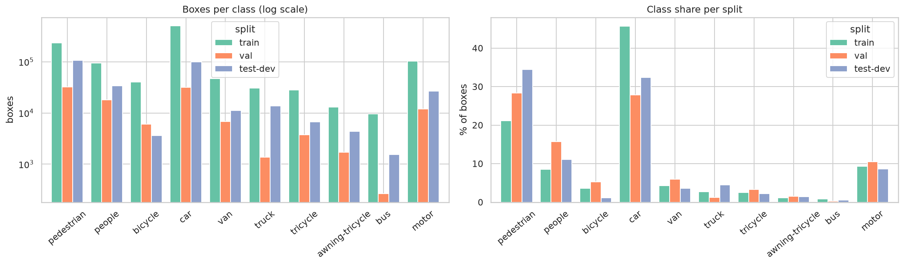
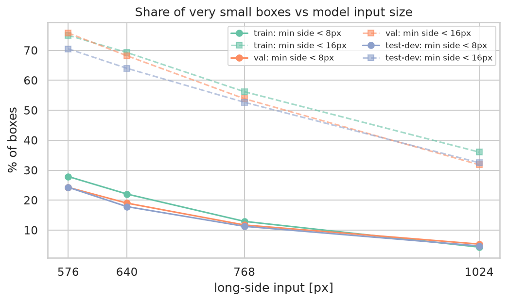
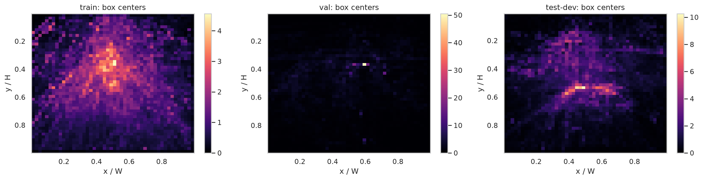
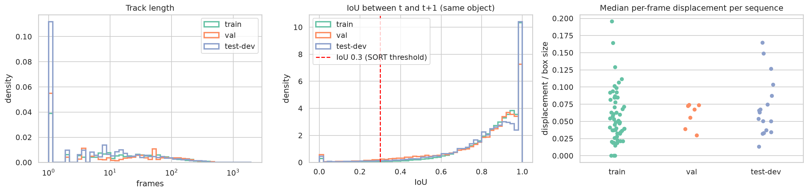

# 2. Bộ dữ liệu VisDrone2019-MOT

Các con số trong tài liệu này được tính trực tiếp trên dữ liệu bằng notebook [01_eda_visdrone_mot.ipynb](../../src/notebooks/01_eda_visdrone_mot.ipynb). Biểu đồ nằm trong [outputs/eda/figures/](../../outputs/eda/figures/), bảng số liệu nằm trong [outputs/eda/tables/](../../outputs/eda/tables/).

## 2.1. Nguồn gốc

VisDrone là bộ benchmark về thị giác máy tính trên ảnh drone do nhóm AISKYEYE (Phòng thí nghiệm Học máy và Khai phá dữ liệu, Đại học Thiên Tân) công bố, gồm năm bài toán. Dự án dùng **Task 4: Multi-Object Tracking**. Video được quay bằng nhiều loại drone ở 14 thành phố của Trung Quốc, bao gồm cảnh đô thị và ngoại ô, ban ngày và ban đêm, ở nhiều độ cao và góc nhìn khác nhau.

| Phần | Dung lượng zip | Nhãn | Dùng trong dự án |
|---|---|---|---|
| trainset | 7,53 GB | Có | Huấn luyện |
| valset | 1,48 GB | Có | Chọn checkpoint và tham số |
| testset-dev | 2,14 GB | Có | Báo cáo kết quả cuối |
| testset-challenge | 2,70 GB | Không | Không dùng |

Dữ liệu được tải từ link Google Drive chính thức trên [GitHub VisDrone](https://github.com/VisDrone/VisDrone-Dataset). Dung lượng file zip val khớp từng byte với bản gốc (1.602.397.759 byte), cả ba file đều vượt qua `unzip -t`, và notebook EDA xác nhận không có ảnh hỏng.

## 2.2. Quy mô

| Split | Số chuỗi | Số frame | Box (lớp 1–10) | Quỹ đạo | Box/frame | Vùng ignored |
|---|---|---|---|---|---|---|
| train | 56 | 24.201 | 1.105.516 | 7.342 | 45,7 | 62.369 |
| val | 7 | 2.846 | 114.132 | 758 | 40,1 | 3.994 |
| test-dev | 17 | 6.635 | 307.799 | 2.293 | 46,4 | 23.472 |
| **Tổng** | **80** | **33.682** | **1.527.447** | **10.393** | **45,3** | **89.835** |

Độ dài chuỗi chênh lệch lớn. Ở train, chuỗi ngắn nhất có 58 frame và dài nhất có 1.424 frame (trung vị 383). Ở val là 184 đến 978 frame, ở test-dev là 146 đến 1.000 frame.

## 2.3. Cấu trúc file gốc

```
VisDrone2019-MOT-<split>/
├── sequences/
│   └── uav0000086_00000_v/       # một chuỗi video
│       ├── 0000001.jpg           # frame đánh số 7 chữ số, bắt đầu từ 1, liên tục
│       └── ...
└── annotations/
    └── uav0000086_00000_v.txt    # một file nhãn cho mỗi chuỗi
```

Tên chuỗi có dạng `uav<mã video>_<frame bắt đầu>_v`. Các chuỗi có cùng mã video là các đoạn cắt khác nhau của cùng một video gốc, ví dụ `uav0000249_00001_v` và `uav0000249_02688_v`.

Mỗi dòng của file nhãn mô tả một box tại một frame:

```
<frame>,<track_id>,<x>,<y>,<w>,<h>,<score>,<class>,<truncation>,<occlusion>
102,0,38,666,71,88,1,1,1,0
```

| Trường | Ý nghĩa |
|---|---|
| `frame` | Số thứ tự frame, trùng với tên file ảnh |
| `track_id` | ID đối tượng, giữ nguyên qua các frame trong cùng một chuỗi |
| `x, y, w, h` | Box theo pixel ảnh gốc, `(x, y)` là góc trên bên trái |
| `score` | Trong ground truth: 1 là box được tính khi đánh giá, 0 là bỏ qua |
| `class` | Mã lớp 0–11 |
| `truncation` | 0 là đối tượng nằm trọn trong ảnh, 1 là bị cắt một phần ở mép |
| `occlusion` | 0 là không bị che, 1 là bị che một phần (1–50%), 2 là bị che nhiều (50–100%) |

## 2.4. Các lớp

| Mã | Lớp | Mô tả | Train | Tracking |
|---|---|---|:-:|:-:|
| 0 | ignored region | Vùng không được gán nhãn đầy đủ (bãi xe, đám đông ở xa) | | lọc |
| 1 | pedestrian | Người đứng hoặc đi bộ | ✓ | ✓ |
| 2 | people | Người ở tư thế khác: ngồi, nằm, đi xe | ✓ | |
| 3 | bicycle | Xe đạp | ✓ | |
| 4 | car | Ô tô con | ✓ | ✓ |
| 5 | van | Xe van, xe tải nhỏ | ✓ | ✓ |
| 6 | truck | Xe tải | ✓ | ✓ |
| 7 | tricycle | Xe ba bánh | ✓ | |
| 8 | awning-tricycle | Xe ba bánh có mái che | ✓ | |
| 9 | bus | Xe buýt | ✓ | ✓ |
| 10 | motor | Xe máy | ✓ | |
| 11 | others | Phương tiện khác | | |

Detector được train trên 10 lớp (mã 1–10) theo cách làm phổ biến của các công trình trên VisDrone. Đánh giá tracking theo chuẩn VisDrone-MOT chỉ dùng 5 lớp: pedestrian, car, van, truck, bus.

## 2.5. Độ phân giải

| Độ phân giải | train | val | test-dev |
|---|---|---|---|
| 680×382 | | | 1 |
| 960×540 | | | 3 |
| 1344×756 | 11 | 2 | 2 |
| 1360×765 | 1 | | 5 |
| 1904×1071 | 30 | 2 | 2 |
| 1920×1080 | 1 | | 3 |
| 2688×1512 | 11 | 1 | |
| 2720×1530 | 2 | 1 | 1 |
| 3840×2160 | | 1 | |

Đơn vị là số chuỗi. Trong cùng một chuỗi, mọi frame có cùng độ phân giải. Train chủ yếu là 1904×1071 và 2688×1512, trong khi test-dev có nhiều ảnh nhỏ hơn. Sự không đồng nhất này là lý do bước tiền xử lý phải ghi kích thước theo từng ảnh.

## 2.6. Phân bố lớp

| Lớp | train | % | val | % | test-dev | % |
|---|---|---|---|---|---|---|
| pedestrian | 234.305 | 21,2 | 32.404 | 28,4 | 106.184 | 34,5 |
| people | 94.396 | 8,5 | 17.908 | 15,7 | 33.999 | 11,0 |
| bicycle | 40.255 | 3,6 | 6.022 | 5,3 | 3.637 | 1,2 |
| car | 505.301 | 45,7 | 31.821 | 27,9 | 99.727 | 32,4 |
| van | 46.940 | 4,2 | 6.842 | 6,0 | 11.223 | 3,6 |
| truck | 30.498 | 2,8 | 1.359 | 1,2 | 13.708 | 4,5 |
| tricycle | 28.338 | 2,6 | 3.769 | 3,3 | 6.721 | 2,2 |
| awning-tricycle | 13.011 | 1,2 | 1.718 | 1,5 | 4.354 | 1,4 |
| bus | 9.653 | 0,9 | 264 | 0,2 | 1.536 | 0,5 |
| motor | 102.819 | 9,3 | 12.025 | 10,5 | 26.710 | 8,7 |

Dữ liệu mất cân bằng mạnh, lớp lớn nhất (`car`) gấp khoảng 52 lần lớp nhỏ nhất (`bus`) trong train. Phân bố cũng lệch giữa các split, khi val và test-dev có nhiều `pedestrian` hơn và ít `car` hơn train. Hai lớp tracking là `bus` và `truck` có rất ít mẫu, riêng val chỉ có 264 box `bus` thuộc 51 quỹ đạo ở train, nên chỉ số của hai lớp này sẽ có phương sai lớn.



## 2.7. Kích thước đối tượng

Kích thước được đo bằng căn bậc hai diện tích box, theo pixel ảnh gốc. Phân nhóm theo chuẩn COCO: small dưới 32², medium từ 32² đến 96², large từ 96² trở lên.

| Split | p5 | p25 | Trung vị | p75 | p95 | Small | Medium | Large |
|---|---|---|---|---|---|---|---|---|
| train | 19,7 | 32,0 | 45,8 | 67,9 | 130,2 | 24,9% | 63,5% | 11,6% |
| val | 22,6 | 35,5 | 52,4 | 73,2 | 130,7 | 19,2% | 69,5% | 11,3% |
| test-dev | 14,3 | 21,9 | 33,4 | 56,1 | 106,0 | 47,8% | 45,4% | 6,8% |

Test-dev có đối tượng nhỏ hơn hẳn train, với tỉ lệ box small gần gấp đôi. Đây là nguyên nhân chính khiến mAP trên test-dev sẽ thấp hơn val.

Theo lớp (train), các lớp nhỏ nhất là `pedestrian` (cạnh trung vị 35,7 px, 39,4% small), `people` (36,0 px), `motor` (40,2 px) và `bicycle` (41,4 px). Lớn nhất là `bus` (113,4 px, 4,1% small) và `truck` (73,5 px).

### Kích thước sau khi resize về input của mô hình

Mô hình không nhìn ảnh gốc mà nhìn ảnh đã resize. Bảng dưới mô phỏng việc resize cạnh dài của ảnh về R pixel.

| Input | Split | Cạnh ngắn < 8 px | Cạnh ngắn < 16 px | Small | Cạnh trung vị |
|---|---|---|---|---|---|
| 576 | train | 27,9% | 75,0% | 91,8% | 13,7 px |
| 576 | test-dev | 24,3% | 70,5% | 90,8% | 14,4 px |
| 640 | train | 22,0% | 69,3% | 89,0% | 15,2 px |
| 768 | train | 12,9% | 56,2% | 83,4% | 18,2 px |
| 1024 | train | 4,3% | 36,0% | 69,2% | 24,3 px |
| 1024 | test-dev | 4,7% | 32,5% | 64,7% | 25,6 px |

Ở input 576, cạnh trung vị chỉ còn khoảng 14 px, nhỏ hơn một patch 16 px của backbone RF-DETR, và gần 28% box train có cạnh ngắn dưới 8 px. Đây là phát hiện quan trọng nhất của phần thống kê: **độ phân giải đầu vào là nút thắt chính** trên bộ dữ liệu này.



## 2.8. Tỉ lệ khung hình

| Lớp | w/h trung vị | Khoảng p5–p95 |
|---|---|---|
| pedestrian | 0,47 | 0,33 – 0,75 |
| people | 0,61 | 0,41 – 1,00 |
| bicycle | 0,95 | 0,45 – 1,92 |
| car | 1,25 | 0,73 – 2,69 |
| van | 1,11 | 0,65 – 2,04 |
| truck | 1,08 | 0,70 – 2,53 |
| bus | 1,03 | 0,58 – 3,58 |
| motor | 0,80 | 0,46 – 1,71 |

Người có box đứng, ô tô có box nằm ngang, các phương tiện khác gần vuông. Khoảng p5–p95 rộng vì cùng một đối tượng có tỉ lệ khác nhau tùy góc nhìn của drone.

## 2.9. Mật độ

| Split | Trung bình | Trung vị | p95 | p99 | Max | Frame > 100 box |
|---|---|---|---|---|---|---|
| train | 45,7 | 43 | 118 | 142 | 180 | 1.851 (7,6%) |
| val | 40,1 | 37 | 103 | 112 | 116 | 183 (6,4%) |
| test-dev | 46,4 | 37 | 104 | 128 | 152 | 441 (6,6%) |

Frame đông nhất là `train/uav0000295_02300_v/0000322.jpg` với 180 box. Không có frame nào vượt 300 box, nên 300 query mặc định của RF-DETR là đủ. Chỉ có 3 frame train không có đối tượng nào.

## 2.10. Che khuất và bị cắt mép

| Split | Không che | Che một phần | Che nhiều | Bị cắt mép |
|---|---|---|---|---|
| train | 54,3% | 40,3% | 5,3% | 4,3% |
| val | 40,9% | 52,4% | 6,6% | 5,3% |
| test-dev | 47,9% | 42,6% | 9,5% | 4,4% |

Lớp bị che nhiều nhất là `people` (68,9% che một phần, do thường ngồi trên xe hoặc đứng thành nhóm) và `truck` (15,8% che nhiều).

## 2.11. Phân bố không gian

Tâm box tập trung ở dải giữa ảnh (46,6% ở train, 58,0% ở val, 52,5% ở test-dev) và nửa trên (27–32%), ít ở dải dưới (15–22%). Camera nhìn xiên nên phần trên ảnh là vùng xa, chứa nhiều đối tượng nhỏ và dày; phần dưới là vùng gần, đối tượng lớn nhưng thưa. Do vị trí dọc trong ảnh gắn với kích thước đối tượng, phép lật dọc khi augmentation sẽ tạo cảnh phi thực tế.



## 2.12. Quỹ đạo và chuyển động

| Split | Số quỹ đạo | Độ dài trung vị | p95 | Max | Quỹ đạo < 10 frame | Có đoạn đứt |
|---|---|---|---|---|---|---|
| train | 7.342 | 103 | 414 | 1.255 | 4,3% | 6,9% |
| val | 758 | 124 | 379 | 978 | 3,6% | 11,3% |
| test-dev | 2.293 | 100 | 328 | 766 | 6,9% | 7,3% |

"Có đoạn đứt" nghĩa là đối tượng biến mất ở một số frame giữa chừng rồi xuất hiện lại cùng ID, thường do bị che hoặc ra khỏi khung hình. Có 229 quỹ đạo train đổi lớp giữa chừng, chủ yếu giữa `pedestrian` và `people`.

| Split | IoU(t, t+1) trung vị | IoU < 0,5 | IoU < 0,3 | IoU = 0 | Dịch chuyển trung vị | Dịch chuyển p95 |
|---|---|---|---|---|---|---|
| train | 0,897 | 4,1% | 1,6% | 0,6% | 2,0 px (0,04 box) | 14,7 px (0,26 box) |
| val | 0,873 | 10,9% | 4,2% | 1,1% | 2,5 px (0,05 box) | 27,0 px (0,51 box) |
| test-dev | 0,875 | 7,1% | 3,2% | 0,9% | 1,8 px (0,05 box) | 13,5 px (0,35 box) |

IoU giữa hai frame liên tiếp của cùng một đối tượng rất cao. Nếu detector phát hiện đủ, các tracker dựa trên IoU đã có thể liên kết phần lớn quỹ đạo, nên sai số tracking chủ yếu sẽ đến từ detector. Val có chuyển động mạnh hơn train. Các chuỗi có camera di chuyển nhanh nhất là `train/uav0000218_00001_v`, `test-dev/uav0000249_02688_v` và `train/uav0000289_06922_v`.



## 2.13. Vùng ignored

| Split | Số vùng | % frame có vùng ignored | Diện tích/frame trung vị | p95 | Max |
|---|---|---|---|---|---|
| train | 62.369 | 72,7% | 1,7% | 11,6% | 38,5% |
| val | 3.994 | 50,4% | 1,4% | 9,5% | 11,1% |
| test-dev | 23.472 | 85,8% | 2,6% | 11,2% | 15,6% |

Khoảng 1% box đối tượng (11.528 ở train, 1.228 ở val, 3.570 ở test-dev) có tâm nằm trong vùng ignored. Vùng ignored không có nghĩa là "không có đối tượng" mà là "không gán nhãn đầy đủ", nên không được tô đen ảnh, và detection rơi vào vùng này phải được loại trước khi tính chỉ số.

## 2.14. Chất lượng nhãn

| Kiểm tra (lớp 1–10) | train | val | test-dev |
|---|---|---|---|
| Box kích thước 0 hoặc âm | 0 | 0 | 0 |
| Box vượt ra ngoài ảnh | 31 | 0 | 3 |
| Box có cạnh < 4 px | 0 | 0 | 0 |
| Tỉ lệ khung hình > 10 hoặc < 0,1 | 100 | 26 | 9 |
| `score = 0` trên lớp đối tượng | 0 | 0 | 0 |
| Trùng (chuỗi, frame, ID) | 0 | 0 | 0 |
| Box trùng hoàn toàn | 0 | 0 | 2 |

Nhãn rất sạch. 34 box vượt ra ngoài ảnh chỉ lệch 1–2 px và được clip trong bước tiền xử lý.

## 2.15. Độ dư thừa giữa các frame

Sai khác pixel trung bình (ảnh xám 240×135, thang 0–255) giữa frame t và t + k, lấy mẫu 280 cặp trên train:

| k | 1 | 2 | 5 | 10 | 30 |
|---|---|---|---|---|---|
| Sai khác | 4,67 | 7,11 | 11,49 | 15,30 | 21,60 |

Frame liên tiếp gần như trùng nhau. Lấy mẫu stride 2 giảm số ảnh train từ 24.201 xuống 12.114 nhưng giữ 7.312/7.342 quỹ đạo (99,6%) và tỉ lệ lớp lệch tối đa 0,016 điểm phần trăm. Đây là căn cứ cho quyết định lấy mẫu ở chương 3.

## 2.16. Tóm tắt các thách thức

| Thách thức | Số liệu | Hệ quả |
|---|---|---|
| Đối tượng rất nhỏ | 27,9% box có cạnh < 8 px ở input 576 | Cần độ phân giải cao, báo cáo AP_small |
| Lệch phân phối giữa split | Small 24,9% ở train, 47,8% ở test-dev | mAP test-dev thấp hơn val |
| Mất cân bằng lớp | 52 lần | Lớp hiếm có chỉ số dao động lớn |
| Mật độ cao | Tối đa 180 box/frame | Giới hạn số box đầu ra phải đủ lớn |
| Che khuất | 46–59% box bị che | Gây mất box và đổi ID |
| Camera chuyển động | Dịch chuyển p95 tới 0,51 box ở val | Lợi thế cho tracker có bù chuyển động camera |
| Frame dư thừa | Sai khác 4,7/255 giữa frame liên tiếp | Lấy mẫu stride 2, giữ split theo chuỗi |
